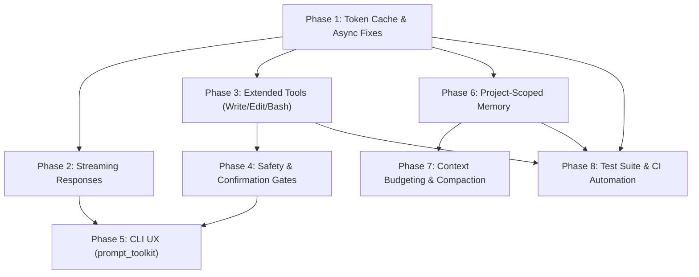

# CLI-Agent Master Architectural Roadmap

## 1. Executive Summary

`cli-agent` is an autonomous developer assistant designed to operate directly on developer workstations via Google Cloud Vertex AI (Gemini 3.8 Flash). It provides an interactive REPL, one-shot command execution, local file discovery, and persistent SQLite memory with FTS5 full-text search.

To evolve `cli-agent` from a proof-of-concept prototype into a robust, extensible, and production-grade developer tool, this roadmap outlines a modular, phased architectural plan.

```
                    ┌─────────────────────────────────────────┐
                    │               CLI Interface             │
                    │   (prompt_toolkit / Rich Console REPL)  │
                    └───────────────────┬─────────────────────┘
                                        │
                                        ▼
                    ┌─────────────────────────────────────────┐
                    │            Agent Orchestrator           │
                    │       (Turn Loop & Tool Dispatcher)     │
                    └─────────┬───────────────────┬───────────┘
                              │                   │
            ┌─────────────────┴──────┐     ┌──────┴──────────────────┐
            ▼                        ▼     ▼                         ▼
┌───────────────────────┐ ┌──────────────┐ ┌────────────────┐ ┌───────────────┐
│ Vertex Client Engine  │ │ Tool Runtime │ │ SQLite Memory  │ │ Security &    │
│ - Token Cache         │ │ - File Read  │ │ - FTS5 Search  │ │ Approval Gate │
│ - Streaming (SSE)     │ │ - File Edit  │ │ - Project Scope│ │ - Dangerous   │
│ - Exponential Backoff │ │ - Shell Exec │ │ - Auto-Pruning │ │   Commands    │
└───────────────────────┘ └──────────────┘ └────────────────┘ └───────────────┘
```

---

## 2. Phased Architecture Breakdown

The improvement plan is decomposed into five dedicated technical specifications:

| Document | Focus Area | Primary Objective |
| :--- | :--- | :--- |
| [01_core_architecture_and_performance.md](01_core_architecture_and_performance.md) | Vertex Client & Event Loop | Non-blocking token caching, SSE streaming, resilient HTTP retries. |
| [02_agent_capabilities_and_tools.md](02_agent_capabilities_and_tools.md) | Tooling & Action Engine | File creation/patching, sandboxed terminal execution, safety gates. |
| [03_memory_and_context_management.md](03_memory_and_context_management.md) | Memory & Context Window | Multi-project workspace isolation, session compaction, token budgeting. |
| [04_cli_ux_and_dx.md](04_cli_ux_and_dx.md) | Developer Experience | `prompt_toolkit` integration, syntax highlighting, slash commands, config. |
| [05_testing_quality_and_ci.md](05_testing_quality_and_ci.md) | Quality & Verification | Comprehensive test harness (pytest/asyncio), linting (Ruff), CI pipeline. |

---

## 3. Dependency Graph & Critical Path



---

## 4. Key Architectural Decisions (ADR Summary)

### ADR-01: In-Memory Token Caching with Asynchronous Refresh
- **Context:** `gcloud auth print-access-token` is executed synchronously via `subprocess.run` inside `VertexAgentClient.chat()`, causing 500ms–1200ms latency penalties on every tool loop iteration and blocking the asyncio event loop.
- **Decision:** Implement a dedicated `TokenProvider` class that stores the token in memory with an expiration timestamp (~55 minutes), refreshed asynchronously via `asyncio.to_thread` or native `google-auth` library credentials.
- **Consequence:** Eliminates blocking operations, reduces agent roundtrip latency by up to 80%.

### ADR-02: Human-in-the-Loop Confirmation for Mutation Tools
- **Context:** Enabling write/edit and shell command tools introduces risks of accidental data loss or destructive commands.
- **Decision:** Implement a security policy interceptor in the tool dispatcher. Read-only tools (`read_file`, `search_code`) run immediately; mutation tools (`write_file`, `edit_file`, `run_command`) trigger an interactive user prompt before execution unless explicit `--dangerously-skip-permissions` flag is set.
- **Consequence:** Secure execution without unexpected side effects.

### ADR-03: Workspace/Project Scoping in Persistent Memory
- **Context:** Memory storage currently writes all facts to a single global SQLite file (`~/.config/cli-agent/memory.db`) without workspace metadata.
- **Decision:** Add a `project_id` or `workspace_root` column derived from `git rev-parse --show-toplevel` or current working directory hash.
- **Consequence:** Contextual recall prevents cross-project pollution while retaining global personal preferences.

---

## 5. Success Metrics & Verification Milestones

1. **Latency:** Mean first-token delivery dropped from ~2.5s (blocking) to <600ms via streaming.
2. **Autonomy:** Agent successfully fixes bugs and applies multi-file edits verified by unit tests.
3. **Robustness:** Zero unhandled event-loop freezes on network timeout or API rate-limiting (HTTP 429).
4. **Coverage:** >85% unit test coverage across tool executors, memory FTS5 triggers, and client retry logic.
