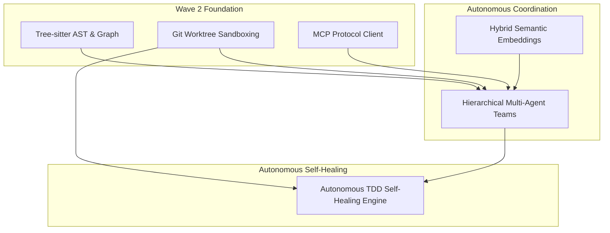

# Wave 2 Architecture: Autonomous Enterprise Engineering System

## 1. Executive Summary & Vision

While Wave 1 transformed `cli-agent` into a robust, reactive CLI developer assistant (token caching, streaming SSE, SQLite FTS5 memory, HITL security, and strict ISO/IEC 25010 testing), **Wave 2 elevates the system into a fully autonomous, enterprise-grade software engineering platform**.

Wave 2 shifts `cli-agent` from a "single-turn reactive tool user" to an **autonomous engineering swarm** capable of parsing ASTs, maintaining code dependency graphs, sandboxing changes in ephemeral Git worktrees, federating external capabilities via MCP, and executing autonomous test-driven self-healing loops.

```
                                  ┌──────────────────────────────────────────────┐
                                  │          Wave 2 Autonomous Engine            │
                                  └──────────────────────┬───────────────────────┘
                                                         │
                        ┌────────────────────────────────┼───────────────────────────────┐
                        │                                │                               │
                        ▼                                ▼                               ▼
         ┌─────────────────────────────┐  ┌─────────────────────────────┐  ┌─────────────────────────────┐
         │     Code Intelligence       │  │    Execution Sandboxing     │  │   Multi-Agent Swarm (ODD)   │
         │ - Tree-sitter AST Parsing   │  │ - Ephemeral Git Worktrees   │  │ - Lead Planner / Architect  │
         │ - Symbol & Call-Graph Index │  │ - Isolated Build & Test Env │  │ - Parallel Coding Workers   │
         │ - Cross-Reference Engine    │  │ - Atomic Diff & Patch Review│  │ - Independent QA Verifier   │
         └──────────────┬──────────────┘  └──────────────┬──────────────┘  └──────────────┬──────────────┘
                        │                                │                                │
                        └────────────────────────────────┼────────────────────────────────┘
                                                         │
                        ┌────────────────────────────────┼───────────────────────────────┐
                        │                                │                               │
                        ▼                                ▼                               ▼
         ┌─────────────────────────────┐  ┌─────────────────────────────┐  ┌─────────────────────────────┐
         │    Universal MCP Client     │  │   Autonomous TDD Self-Heal  │  │   Hybrid Semantic Search    │
         │ - Stdio & SSE Transports    │  │ - Automated Failing Test Gen│  │ - Vertex AI Embeddings      │
         │ - Dynamic Server Registry   │  │ - Iterative Repair Loop     │  │ - Reciprocal Rank Fusion    │
         │ - Postgres / GitHub / Cloud │  │ - Regression Verification   │  │ - FTS5 + Vector Cosine Sim  │
         └─────────────────────────────┘  └─────────────────────────────┘  └─────────────────────────────┘
```

---

## 2. Wave 2 Specifications Suite

| Specification | Primary Scope | Enterprise Objective |
| :--- | :--- | :--- |
| [01_tree_sitter_ast_and_code_graph.md](01_tree_sitter_ast_and_code_graph.md) | Code Intelligence | Replace raw regex with Tree-sitter AST parsing; extract classes, functions, references, and dependency call graphs. |
| [02_git_worktree_sandboxing_and_diff_engine.md](02_git_worktree_sandboxing_and_diff_engine.md) | Sandboxing & Safety | Execute all coding mutations inside isolated Git worktrees; never mutate developer working trees directly without verified tests. |
| [03_hierarchical_multi_agent_teams.md](03_hierarchical_multi_agent_teams.md) | Multi-Agent Swarm | Decompose complex objectives into a team of bounded agents: Lead Architect, Feature Workers, and QA/Verifier. |
| [04_model_context_protocol_mcp_client.md](04_model_context_protocol_mcp_client.md) | Extensibility (MCP) | Full client implementation for Model Context Protocol; dynamic connection to GitHub, Databases, Docker, and external MCP servers. |
| [05_autonomous_self_healing_tdd_loop.md](05_autonomous_self_healing_tdd_loop.md) | Self-Healing TDD | Given a bug description: synthesize reproducing tests, run until fail, iteratively patch code, verify 100% green without regressions. |
| [06_hybrid_code_search_and_embeddings.md](06_hybrid_code_search_and_embeddings.md) | Semantic Retrieval | Combine SQLite FTS5 BM25 keyword matching with Vertex AI dense vector embeddings via Reciprocal Rank Fusion (RRF). |
| [07_model_garden_catalog_and_filtering.md](07_model_garden_catalog_and_filtering.md) | Dynamic Model Discovery | Live querying of Vertex AI Model Garden (Gemini, Claude, Grok, Codestral) with smart capability and obsolescence filtering. |

---

## 3. High-Level Dependency Graph & Roadmap


