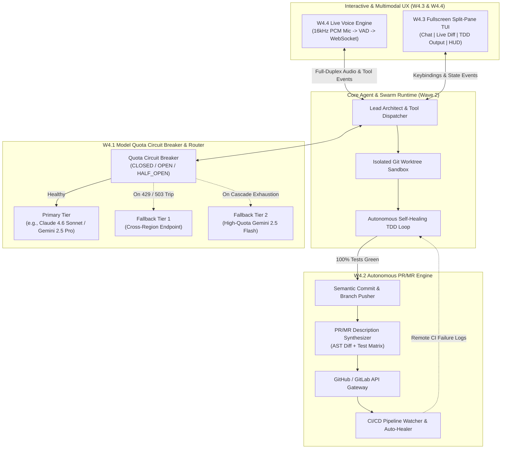

# Wave 4: Autonomous Delivery & Production Workflows
## 00. Executive Architecture & System Topology

### 1. Executive Summary & Vision

With Wave 1 establishing core reactive ergonomics, Wave 2 introducing autonomous engineering swarms (AST intelligence, Git worktree sandboxing, hierarchical multi-agent teams, MCP, and self-healing TDD), and Wave 3 guaranteeing frictionless GCP pre-flight onboarding, **Wave 4 elevates `cli-agent` into a resilient, multimodal, continuous delivery platform**.

In real-world enterprise operations, autonomous engineering workflows encounter production constraints: upstream LLM quota saturation (`429 RESOURCE_EXHAUSTED`), manual bottlenecks when converting local verified branches into peer-reviewed Pull/Merge Requests, terminal information overload during concurrent multi-agent execution, and high friction when developers want hands-free architectural pair-programming.

Wave 4 resolves these operational bottlenecks across four pillars:
- **W4.1 Model Quota Circuit Breaker & Automatic Fallback**: Zero-downtime inference continuity via stateful circuit breakers and multi-region/cross-family fallback routing.
- **W4.2 Autonomous GitHub/GitLab PR Engine**: End-to-end delivery from issue ingestion and sandboxed TDD verification to automated branch push, semantic commit formatting, and structured PR/MR creation with CI check monitoring.
- **W4.3 Fullscreen Split-Pane TUI**: A high-density, low-latency terminal user interface built on `Textual` / `prompt_toolkit` providing concurrent views of agent reasoning, live AST/file diffs, worktree telemetry, and token/quota health.
- **W4.4 Multimodal Live Voice Streaming**: Hands-free, low-latency bidirectional voice and audio streaming powered by Vertex AI Gemini Live WebSocket APIs with Voice Activity Detection (VAD) and barge-in interruption support.

```
+---------------------------------------------------------------------------------------------------+
|                      Wave 4: Autonomous Delivery & Production Workflows                           |
+---------------------------------------------------------------------------------------------------+
                                                 │
         ┌───────────────────────────────────────┴───────────────────────────────────────┐
         ▼                                                                               ▼
┌─────────────────────────────────────────────────┐             ┌─────────────────────────────────────────────────┐
│   Interactive & Multimodal Experience Layer     │             │     Resilient Execution & Delivery Engine       │
├────────────────────────┬────────────────────────┤             ├────────────────────────┬────────────────────────┤
│  W4.3 Fullscreen       │  W4.4 Multimodal       │             │  W4.1 Model Quota      │  W4.2 Autonomous       │
│  Split-Pane TUI        │  Live Voice Streaming  │             │  Circuit Breaker       │  GitHub/GitLab PR      │
│                        │                        │             │                        │                        │
│ - Multi-pane layout    │ - Full-duplex audio    │             │ - 429 / 503 detection  │ - Issue/Ticket parser  │
│ - Live unified diff    │ - WebSocket PCM stream │             │ - Half-open probing    │ - Worktree -> Branch   │
│ - Sub-agent tree view  │ - VAD & barge-in       │             │ - Tiered model routing │ - Auto PR/MR synthesis │
│ - Quota/Token HUD      │ - Audio device guard   │             │ - Cross-region failover│ - CI pipeline watcher  │
└────────────┬───────────┴───────────┬────────────┘             └────────────┬───────────┴───────────┬────────────┘
             │                       │                                       │                       │
             └───────────────────────┴───────────────────┬───────────────────┴───────────────────────┘
                                                         ▼
                         ┌───────────────────────────────────────────────────────────────┐
                         │        Wave 2 & Wave 3 Core Foundation (AST, TDD, IAM)        │
                         └───────────────────────────────────────────────────────────────┘
```

---

### 2. Core Architectural Pillars (W4.1 – W4.4)

#### W4.1: Model Quota Circuit Breaker & Automatic Fallback
Long-running autonomous TDD loops and multi-agent swarms generate bursty token traffic that frequently triggers Vertex AI per-minute quota limits (`HTTP 429 RESOURCE_EXHAUSTED`) or transient regional capacity errors (`HTTP 503 SERVICE_UNAVAILABLE`).
- **State Machine**: Each `(model_id, region)` endpoint is wrapped in a stateful Circuit Breaker (`CLOSED` $\rightarrow$ `OPEN` $\rightarrow$ `HALF_OPEN`).
- **Fallback Chain**: When a primary model trips its breaker (e.g., `claude-sonnet-4-6@us-east5`), the router transparently fails over to secondary regions or equivalent capability tiers (e.g., `gemini-2.5-pro@us-central1` $\rightarrow$ `gemini-2.5-flash@global`) while preserving conversation history and tool schemas.
- **Context Continuity**: Normalizes system prompts, thinking budgets, and tool-call payloads across Vertex Gemini and Anthropic Partner endpoints mid-session without dropping state.

#### W4.2: Autonomous GitHub/GitLab PR Engine
Bridges the gap between a green local Git worktree sandbox (Wave 2) and production code review platforms:
- **Provider Abstraction**: Unified `GitHostProvider` interface supporting GitHub (`gh` CLI / REST & GraphQL APIs) and GitLab (`glab` CLI / REST API v4).
- **Automated Delivery Pipeline**: Extracts semantic commit messages from AST symbol diffs, pushes isolated worktree branches to remote origins, and synthesizes comprehensive PR/MR descriptions (Architectural Summary, Root Cause Analysis, Test Coverage Matrix, and Security Audit).
- **CI/CD Feedback Loop**: Polls remote GitHub Actions or GitLab CI pipelines and feeds failing check logs directly back into the Wave 2 Self-Healing TDD Engine for autonomous remediation.

#### W4.3: Fullscreen Split-Pane TUI
Replaces scrolling single-stream stdout with an optional, keyboard-driven (`--tui` or `/tui`) fullscreen terminal workspace:
- **Left Pane (Conversation & Swarm Telemetry)**: Streaming Markdown chat, collapsible `<thought>` blocks, and hierarchical sub-agent execution trees (`Lead` $\rightarrow$ `Worker` $\rightarrow$ `QA`).
- **Right Top Pane (Live Diff & Code Inspector)**: Real-time syntax-highlighted unified/side-by-side diffs of active worktree modifications and AST symbol outlines.
- **Right Bottom Pane (Terminal & TDD Runner)**: Live streaming stdout/stderr of `pytest`, linters, and MCP server calls.
- **Bottom Status HUD**: Real-time token consumption, active model/region indicator, circuit breaker health status, and voice microphone state.

#### W4.4: Multimodal Live Voice Streaming
Enables low-latency spoken dialogue with the codebase while preserving full tool-execution capabilities:
- **Bidirectional Streaming**: Persistent full-duplex WebSocket session to Vertex AI Gemini Live (`BidiGenerateContent`) streaming 16kHz 16-bit mono PCM audio input and 24kHz audio output.
- **Voice Activity Detection (VAD) & Barge-In**: Local energy/WebRTC VAD detects developer speech immediately, truncating ongoing TTS playback and canceling stale generation turns.
- **Voice-to-Tool Bridge**: Spoken architectural commands trigger real-time AST searches, file edits, and TDD runs, with visual diffs rendered simultaneously in the Split-Pane TUI.

---

### 3. System Topology & Data Flow



---

### 4. Architectural Design Principles

1. **Zero-Interruption Inference Continuity**: A `429 RESOURCE_EXHAUSTED` error from a single model or GCP region must never abort an in-progress multi-agent workflow or discard accumulated tool state. Fallback transitions must complete in `< 250ms` with clear HUD telemetry.
2. **Human-Gated Production Push (Configurable HITL)**: While branch preparation, test verification, and PR description drafting are fully autonomous, pushing branches to remote repositories and opening PRs defaults to a single confirmation gate unless explicitly invoked with `--auto-pr`.
3. **Graceful Hardware & Terminal Degradation**:
   - If audio hardware (`PortAudio` / `ALSA` / `PulseAudio`) is unavailable or running over headless SSH, W4.4 cleanly disables voice streaming without affecting CLI/TUI startup.
   - If terminal dimensions are below minimum thresholds (`< 100x24`) or running in a non-interactive CI pipeline, W4.3 automatically degrades to standard linear stdout mode.
4. **Cross-Provider Payload Normalization**: Fallback between Anthropic Claude and Google Gemini models automatically translates message roles, tool schemas, and `tool_result` blocks so that mid-turn failovers remain mathematically lossless.

---

### 5. Wave 4 Module Index & Specifications Matrix

| Spec ID | Specification Document | Focus Area | Key Components & Deliverables |
| :--- | :--- | :--- | :--- |
| **W4.1** | **[01_model_quota_circuit_breaker_and_fallback.md](01_model_quota_circuit_breaker_and_fallback.md)** | Resilience & Routing | `QuotaCircuitBreaker`, sliding-window failure counters, `Retry-After` header parser, cross-family message normalizer, fallback policy chain. |
| **W4.2** | **[02_autonomous_github_gitlab_pr_engine.md](02_autonomous_github_gitlab_pr_engine.md)** | Autonomous Delivery | `GitHostProvider` (GitHub/GitLab), semantic commit generator, PR/MR template builder, remote CI check poller, review-comment repair loop. |
| **W4.3** | **[03_fullscreen_split_pane_tui.md](03_fullscreen_split_pane_tui.md)** | Terminal UX | Fullscreen split-pane layout (`ChatPane`, `DiffInspectorPane`, `TestOutputPane`, `TelemetryHUD`), vim/emacs keybindings, async event bus. |
| **W4.4** | **[04_multimodal_live_voice_streaming.md](04_multimodal_live_voice_streaming.md)** | Multimodal Voice | `VoiceStreamSession`, async PCM capture/playback queues, local VAD + barge-in controller, Gemini Live WebSocket bridge, `/voice` toggle. |

---

### 6. Production Service Level Objectives (SLOs) & Verification Matrix

| Subsystem | Metric / Capability | Target SLO | Verification Method |
| :--- | :--- | :--- | :--- |
| **W4.1 Quota Circuit Breaker** | Failover latency upon `HTTP 429` or `503` detection | `< 200 ms` overhead | Deterministic mock 429 injection & state transition unit tests |
| **W4.1 Quota Circuit Breaker** | Half-open recovery probe interval | Configurable (`default: 60s`) | Time-travel clock tests verifying `OPEN -> HALF_OPEN -> CLOSED` |
| **W4.2 Autonomous PR Engine** | PR synthesis accuracy (AST summary + test report) | `100%` valid Markdown & diff coverage | Snapshot tests against mocked GitHub/GitLab REST API payloads |
| **W4.3 Split-Pane TUI** | Frame rendering latency during token streaming | `>= 30 FPS` (`< 33 ms` render time) | Headless TUI pilot benchmarks under high-frequency SSE chunks |
| **W4.4 Live Voice Streaming** | Barge-in audio cut-off latency on user speech detection | `< 150 ms` | Synthetic PCM audio stream tests with simulated speech energy spikes |
