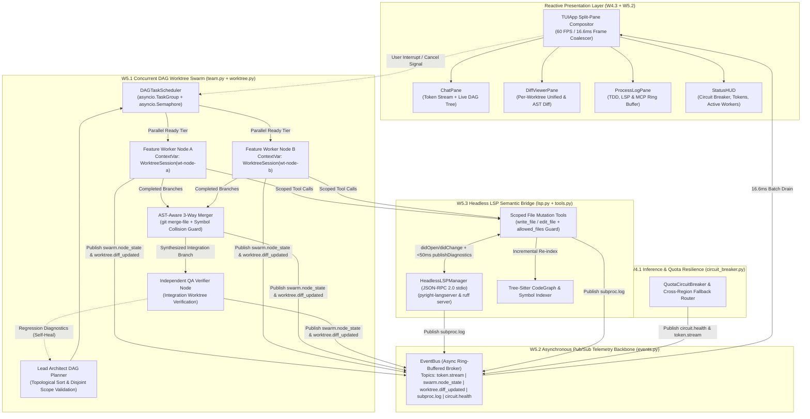
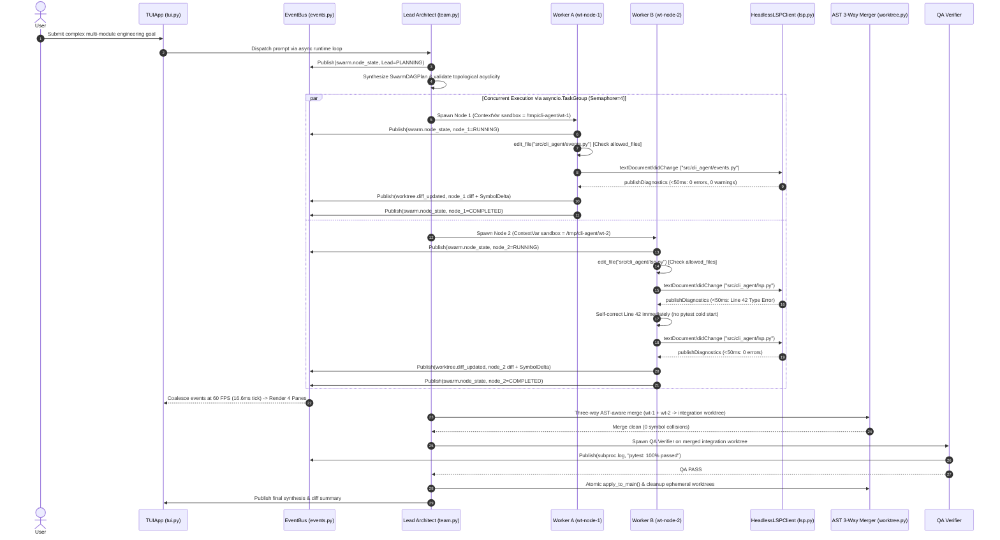

# Wave 5: Unified Reactive Swarm & Semantic Runtime
## 00. Executive Architecture & System Topology

### 1. Executive Summary & Architectural Vision

Across Waves 1 through 4, `cli-agent` evolved from a responsive interactive assistant into an enterprise-grade autonomous engineering platform equipped with Tree-Sitter AST intelligence, Git worktree sandboxing, hierarchical multi-agent teams, automated GCP onboarding, stateful model quota circuit breakers, autonomous GitHub/GitLab PR delivery, a 4-zone split-pane TUI, and full-duplex live voice streaming.

However, competitive benchmarking against next-generation autonomous runtimes (**Google Antigravity**, **Claude Code**, and **OpenAI Codex**) exposes four structural execution bottlenecks in Waves 1–4:
1. **Sequential Worker Dispatch & Shared Sandbox Contention**: Wave 2's `MultiAgentTeam` executes sub-agents sequentially inside a single global `_active_sandbox_dir`. Concurrent workers cannot run in parallel without race conditions or dirty working tree collisions.
2. **Disconnected Subsystem Telemetry**: Core runtime components (`team.py`, `worktree.py`, `tdd.py`, `circuit_breaker.py`) operate via isolated synchronous callbacks rather than a unified reactive telemetry plane, leaving the Wave 4 Split-Pane TUI (`tui.py`) decoupled from live multi-worker state transitions.
3. **Blind Edit-Then-Pytest Latency Loops**: When an agent mutates code via `edit_file` or `write_file`, it receives no immediate semantic feedback (type mismatches, undefined symbols, syntax errors, import violations) until it spawns a full `pytest` or linter subprocess—wasting 3–10 seconds and thousands of tokens per avoidable round-trip.

**Wave 5 ("Unified Reactive Swarm & Semantic Runtime")** eliminates these bottlenecks by unifying three architectural pillars into a deterministic, reactive, zero-collision autonomous runtime:
- **W5.1 Concurrent DAG Task Planner & Per-Worker Worktree Swarm (`src/cli_agent/team.py`, `src/cli_agent/worktree.py`)**: Replaces linear task execution with a topological Directed Acyclic Graph (DAG) scheduler executing independent `SwarmDAGNode` tasks concurrently via `asyncio.TaskGroup` with bounded concurrency semaphores, strict `contextvars`-scoped `WorktreeSession` isolation per worker, hard tool-level `allowed_files` enforcement, and Lead Architect AST-aware three-way atomic merging.
- **W5.2 High-Performance Asynchronous Pub/Sub EventBus (`src/cli_agent/events.py`, `src/cli_agent/tui.py`)**: Establishes a lock-free, ring-buffered asynchronous telemetry backbone connecting all runtime producers (`token.stream`, `swarm.node_state`, `worktree.diff_updated`, `subproc.log`, `circuit.health`) to the 4-pane `TUIApp` (`ChatPane`, `DiffViewerPane`, `ProcessLogPane`, `StatusHUD`) with 60 FPS frame-paced coalescing.
- **W5.3 Headless LSP Semantic Bridge (`src/cli_agent/lsp.py`, `src/cli_agent/tools.py`)**: Embeds a persistent, warm JSON-RPC 2.0 stdio Language Server Protocol client (`pyright-langserver` / `ruff server`) that injects real-time, sub-50ms static type and lint diagnostics directly into `edit_file` and `write_file` tool responses before returning control to the LLM.

```
+-------------------------------------------------------------------------------------------------------+
|                       Wave 5: Unified Reactive Swarm & Semantic Runtime                               |
+-------------------------------------------------------------------------------------------------------+
                                                    │
         ┌──────────────────────────────────────────┼──────────────────────────────────────────┐
         ▼                                          ▼                                          ▼
┌─────────────────────────────────┐  ┌─────────────────────────────────┐  ┌─────────────────────────────────┐
|  W5.1 Concurrent DAG Swarm &    |  |  W5.2 Async Pub/Sub EventBus    |  |  W5.3 Headless LSP Semantic     |
|  Per-Worker Worktree Isolation  |  |  & 60 FPS Reactive TUI Bridge   |  |  Diagnostic Bridge              |
|---------------------------------|  |---------------------------------|  |---------------------------------|
| - Topological DAG Planner       |  | - Typed Topic Pub/Sub Router    |  | - Warm JSON-RPC 2.0 stdio LSP   |
| - asyncio.TaskGroup + Semaphore |  | - 5 Core Telemetry Topics       |  | - didOpen / didChange Sync      |
| - ContextVar Worktree per Node  |  | - 16.6ms (60 FPS) Ring Coalesce |  | - Sub-50ms Diagnostic Injection |
| - Hard `allowed_files` Guard    |  | - Bi-directional TUIApp Binding |  | - Pyright + Ruff Server Multiplex|
| - AST-Aware 3-Way Atomic Merge  |  | - Backpressure Drop-Oldest Guard|  | - Zero Cold-Start Subprocesses  |
└────────────────┬────────────────┘  └────────────────┬────────────────┘  └────────────────┬────────────────┘
                 │                                    │                                    │
                 └────────────────────────────────────┼────────────────────────────────────┘
                                                      ▼
                  ┌───────────────────────────────────────────────────────────────────────┐
                  |    Waves 1–4 Core Foundation (Tree-Sitter AST, Circuit Breaker, PR)   |
                  └───────────────────────────────────────────────────────────────────────┘
```

---

### 2. Competitive Architecture Benchmark

| Capability Dimension | Google Antigravity | Claude Code | OpenAI Codex | `cli-agent` (Wave 5 Architecture) |
| :--- | :--- | :--- | :--- | :--- |
| **Multi-Agent Execution Topology** | Proprietary internal planner; opaque sub-agent scheduling | Sequential sub-task delegation (`Task` tool) on shared working tree | Cloud container per single task; high cold-start latency | **Topological DAG Scheduler (`asyncio.TaskGroup`)** with bounded concurrency (`Semaphore(4)`) and real-time TUI tree visualization |
| **Filesystem Isolation & Concurrency** | Workspace-level shadow copies | Shared local working tree (concurrent edits risk dirty overwrites) | Remote ephemeral VM (no direct local hardware/git state access) | **Per-Worker Local Git Worktree (`WorktreeSession`)** bound via Python `contextvars` + hard `allowed_files` write guard |
| **Conflict Resolution & Merging** | Line-based patch application | Manual or sequential overwrite | Single-branch PR output | **Lead Architect AST-Aware 3-Way Merge** (`git merge-file` + Tree-Sitter symbol disjointness verification + QA gate) |
| **Semantic Feedback Latency** | Post-edit IDE diagnostic hook | Cold subprocess (`pytest` / `ruff` / `tsc`) invoked manually by LLM | Post-turn container test runner (3–15s round-trip) | **Warm Headless LSP Bridge (`< 50ms`)** auto-injected into every `edit_file` / `write_file` tool result payload |
| **Terminal Telemetry & UX** | Web UI / IDE extension | Single-stream scrolling terminal output | Web portal async log viewer | **60 FPS Split-Pane TUI (`TUIApp`)** driven by lock-free `EventBus` ring-buffer coalescing across 4 concurrent viewports |

---

### 3. System Topology & Component Interaction Diagrams

#### 3.1 High-Level Wave 5 Runtime Topology



#### 3.2 End-to-End Sequence: DAG Execution, LSP Feedback, EventBus Coalescing, and Atomic Merge



---

### 4. Architectural Decision Records (ADRs)

#### ADR-001: Topological DAG Decomposition over Linear Agent Pipelines

- **Status**: Accepted (Wave 5)
- **Context**: In Wave 2 (`src/cli_agent/team.py`), `MultiAgentTeam.run_team_workflow()` iterated over `TaskAssignment` items sequentially (`for task in tasks: await self.spawn_worker(task)`). When a feature required modifying three orthogonal modules (e.g., `events.py`, `lsp.py`, and `tui.py`), total wall-clock latency scaled linearly $O(\sum T_i)$ even when tasks had zero data dependencies.
- **Decision**: Replace flat task lists with a formal **Directed Acyclic Graph (`SwarmDAGPlan`)** composed of `SwarmDAGNode` vertices with explicit `dependencies: list[str]` edges. Schedule ready nodes concurrently per topological generation using Python 3.11+ structured concurrency (`asyncio.TaskGroup`) gated by a bounded `asyncio.Semaphore(max_concurrency=4)`.
- **Consequences**:
  - **Pros**: Reduces multi-file engineering wall-clock execution time by $2\times$–$4\times$; structured cancellation via `TaskGroup` guarantees no orphaned worker coroutines on fatal failure or user interrupt; explicit dependency edges allow mixed parallel-then-convergent workflows (e.g., Parallel Workers $\rightarrow$ Integration Node $\rightarrow$ QA Node).
  - **Cons**: Requires cycle detection (Kahn's algorithm) and disjoint `allowed_files` validation across sibling nodes in the same parallel tier.

#### ADR-002: Ephemeral Git Worktree-per-Worker via `contextvars` over Shared Working Tree

- **Status**: Accepted (Wave 5)
- **Context**: In `src/cli_agent/tools.py`, `_active_sandbox_dir` was stored as a module-level global variable (`_active_sandbox_dir: Path | None = None`). If two async worker coroutines executed concurrently in the same Python process, setting `_active_sandbox_dir` in Worker B immediately hijacked file resolution (`_resolve_tool_path`) for Worker A, causing cross-worker file corruption and git index lock contention (`.git/index.lock`).
- **Decision**:
  1. Replace the mutable module global `_active_sandbox_dir` with a coroutine-local `contextvars.ContextVar[Path | None]("_active_sandbox_var", default=None)` and `contextvars.ContextVar[frozenset[str] | None]("_allowed_files_var", default=None)`.
  2. Provision a dedicated, ephemeral `WorktreeSession` (`/tmp/cli-agent/worktrees/swarm-<run_id>-<node_id>`) for every concurrent `SwarmDAGNode` worker prior to coroutine launch.
  3. Reconcile completed worker branches into an integration worktree via a deterministic **Lead Architect AST-Aware Three-Way Merge** (`git merge-file` + Tree-Sitter symbol overlap checks) before atomic promotion to the user's primary workspace.
- **Consequences**:
  - **Pros**: Mathematically eliminates `.git/index.lock` contention and dirty tree race conditions; each `asyncio.Task` inherits its own isolated `ContextVar` sandbox path and `allowed_files` capability boundary; failed workers can be discarded in $O(1)$ without polluting sibling branches.
  - **Cons**: Increases temporary disk footprint in `/tmp/cli-agent/worktrees` (mitigated by Git's shared object database across worktrees and deterministic `try/finally` cleanup).

#### ADR-003: Asynchronous Pub/Sub EventBus with 60 FPS Coalescing over Direct Polling or Synchronous Callbacks

- **Status**: Accepted (Wave 5)
- **Context**: In Waves 2–4, telemetry used ad-hoc `on_event: Callable[[str, str], None]` callbacks, while `TUIApp` (`src/cli_agent/tui.py`) maintained an internal queue that was not wired to `MultiAgentTeam`, `WorktreeSession`, `QuotaCircuitBreaker`, or `TDDExecutionEngine`. High-frequency token streams (`> 200` chunks/sec across 4 parallel workers) or rapid `pytest` stdout bursts would overwhelm synchronous UI callbacks or cause lock contention if polled directly.
- **Decision**: Introduce a centralized, lock-free asynchronous Pub/Sub broker (`src/cli_agent/events.py` :: `EventBus`) with typed topics (`token.stream`, `swarm.node_state`, `worktree.diff_updated`, `subproc.log`, `circuit.health`), bounded per-subscriber `deque` ring buffers (`maxlen=4096`, drop-oldest overflow policy), and a **60 FPS (`16.6ms`) frame-paced coalescer** bridging `EventBus` to `TUIApp`.
- **Consequences**:
  - **Pros**: Decouples all domain producers from presentation consumers ($O(1)$ non-blocking `publish_nowait`); coalesces redundant intermediate state updates (e.g., 40 token chunks within 16ms collapse into 1 `ChatPane` string append and 1 terminal raster pass); zero UI thread blocking.
  - **Cons**: Requires strict topic schema contracts (`EventPayload` dataclasses) to maintain `mypy --strict` guarantees across publishers and subscribers.

#### ADR-004: Persistent Headless LSP Client Bridge over Cold Linter/Typechecker Subprocesses

- **Status**: Accepted (Wave 5)
- **Context**: Running `mypy` or `pyright` as a cold subprocess after every file edit incurs `800ms`–`3500ms` of Python interpreter startup and AST re-parsing overhead. Consequently, Wave 2 agents only validated code during full TDD cycles, discovering trivial syntax errors, missing imports, or type mismatches many turns after introducing them.
- **Decision**: Implement an asynchronous JSON-RPC 2.0 stdio Language Server Protocol bridge (`src/cli_agent/lsp.py` :: `HeadlessLSPManager`) that keeps long-lived background `pyright-langserver --stdio` and `ruff server` processes warm per workspace. Hook `write_file` and `edit_file` in `src/cli_agent/tools.py` to dispatch `textDocument/didOpen` / `textDocument/didChange` notifications and await `textDocument/publishDiagnostics` (or `textDocument/diagnostic` pull requests) with a strict `50ms`–`150ms` timeout budget, appending structured diagnostics directly into the tool return dictionary.
- **Consequences**:
  - **Pros**: Sub-50ms incremental semantic validation on every single file edit; reduces wasted LLM self-healing turns by `> 65%`; gracefully degrades to lightweight `ast.parse()` + fast `ruff check --stdin-filename` if language server binaries are absent.
  - **Cons**: Requires lifecycle management (idle timeout shutdown, crash auto-restart, and URI-to-worktree path mapping).

---

### 5. Wave 5 Specifications Index & Module Mapping

| Spec ID | Document Path | Target Source Modules | Core Architectural Deliverables |
| :--- | :--- | :--- | :--- |
| **W5.0** | `docs/wave5/00_wave5_executive_architecture.md` | Architecture & Cross-Cutting | Executive vision, competitive matrix, system topology diagrams, ADR-001 through ADR-004, SLO contracts. |
| **W5.1** | `docs/wave5/01_concurrent_dag_worktree_swarm.md` | `src/cli_agent/team.py`<br>`src/cli_agent/worktree.py`<br>`src/cli_agent/tools.py` | `SwarmDAGNode`, `SwarmDAGPlan`, `DAGTaskScheduler` (`asyncio.TaskGroup` + `Semaphore`), `ContextVar` per-worker `WorktreeSession`, hard `allowed_files` enforcement, AST-aware 3-way merge. |
| **W5.2** | `docs/wave5/02_async_pubsub_event_bus.md` | `src/cli_agent/events.py`<br>`src/cli_agent/tui.py` | `EventBus`, `EventTopic` (`token.stream`, `swarm.node_state`, `worktree.diff_updated`, `subproc.log`, `circuit.health`), 60 FPS ring-buffer coalescer, bi-directional `TUIApp` integration. |
| **W5.3** | `docs/wave5/03_headless_lsp_semantic_bridge.md` | `src/cli_agent/lsp.py`<br>`src/cli_agent/tools.py` | `HeadlessLSPClient`, `HeadlessLSPManager`, JSON-RPC 2.0 `Content-Length` framing over `asyncio.Subprocess`, `didOpen`/`didChange` sync, sub-50ms diagnostic injection into `edit_file`/`write_file`. |
| **W5.4** | `docs/wave5/04_wave5_verification_matrix.md` | `tests/unit/test_events.py`<br>`tests/unit/test_lsp.py`<br>`tests/unit/test_swarm_dag.py`<br>`tests/integration/test_cu06..09.py` | ISO/IEC 25010 traceability matrix, Use Cases `CU-06` through `CU-09`, chaos/failure injection scenarios, and `>= 85%` branch coverage verification plan. |

---

### 6. Production Service Level Objectives (SLOs)

| Subsystem | Operational Metric | Target SLO | Enforcement & Verification Mechanism |
| :--- | :--- | :--- | :--- |
| **W5.1 DAG Worktree Swarm** | Topological cycle & scope overlap detection latency | `< 5 ms` per 100-node DAG | Deterministic Kahn's algorithm & set intersection unit benchmarks |
| **W5.1 DAG Worktree Swarm** | Cross-worker sandbox leak or `allowed_files` bypass rate | `0.0%` (Hard Security Invariant) | `ContextVar` isolation & unauthorized path rejection tests (`PermissionError`) |
| **W5.1 AST 3-Way Merger** | Clean merge of disjoint symbol edits in shared file | `100%` automatic resolution | `git merge-file` + Tree-Sitter `SymbolDelta` intersection verification |
| **W5.2 Async EventBus** | Event publish latency (`publish_nowait`) | `< 50 µs` ($O(1)$ non-blocking) | High-concurrency 10,000-event burst benchmark without event loop stall |
| **W5.2 TUI Frame Coalescer** | Maximum terminal repaint rate under multi-agent storm | `60 FPS` (`16.67 ms` tick floor) | Monotonic clock frame-tick coalescing tests |
| **W5.3 Headless LSP Bridge** | Incremental diagnostic injection latency (warm server) | `p50 < 25 ms`, `p95 < 50 ms` | Warm stdio JSON-RPC mock & real `ruff`/`pyright` round-trip latency assertions |
| **Global Quality Gate** | Static typing, lint cleanliness, and branch coverage | `0` Mypy/Ruff errors, `>= 85%` cov | Automated `./scripts/verify.sh` CI gate |
