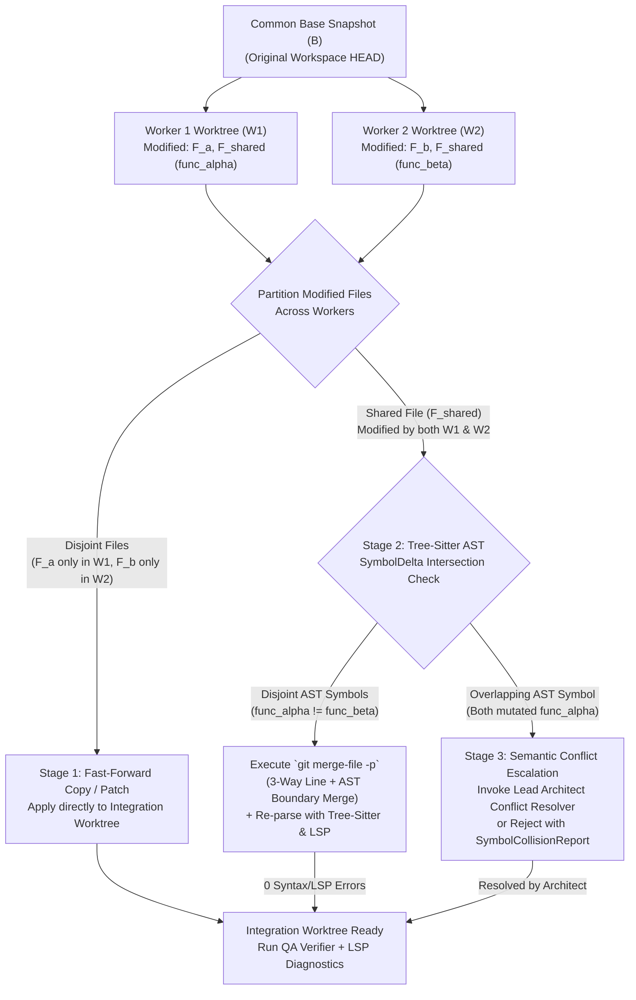

# Wave 5: Unified Reactive Swarm & Semantic Runtime
## 01. Concurrent DAG Task Planner & Per-Worker Worktree Swarm (W5.1)

### 1. Problem Statement & Architectural Goals

In Wave 2 (`src/cli_agent/team.py` and `src/cli_agent/worktree.py`), `MultiAgentTeam` introduced role-specialized sub-agents (`ARCHITECT`, `WORKER`, `QA`) and ephemeral Git worktrees. However, four critical limitations prevented true concurrent multi-agent execution:

1. **Sequential Execution Bottleneck**: `MultiAgentTeam.run_team_workflow()` iterated over `list[TaskAssignment]` in a sequential `for` loop (`for task in tasks: await self.spawn_worker(task)`). Independent tasks that could execute simultaneously were serialized.
2. **Global Mutable Sandbox State**: `src/cli_agent/tools.py` tracked the active worktree directory in a single module-level global `_active_sandbox_dir: Path | None = None`. Running two workers concurrently inside the same event loop caused race conditions where Worker B overwrote `_active_sandbox_dir`, redirecting Worker A's file reads and writes into Worker B's sandbox.
3. **Soft Prompt-Only Scope Enforcement**: `TaskAssignment.allowed_files` was injected into the worker's system prompt (`"You must strictly restrict edits to your approved files"`), but `write_file()` and `edit_file()` in `src/cli_agent/tools.py` did not programmatically enforce this boundary. A hallucinating sub-agent could mutate arbitrary files across the repository.
4. **Naive Patch Application**: `WorktreeSession.apply_to_main()` executed a raw `git apply` against a single worktree diff. It lacked multi-branch three-way reconciliation and could not merge concurrent worker branches that modified either disjoint files or disjoint AST symbols within the same file.

**Milestone W5.1** re-architects `src/cli_agent/team.py`, `src/cli_agent/worktree.py`, and `src/cli_agent/tools.py` into a **Concurrent Directed Acyclic Graph (DAG) Worktree Swarm** featuring:
- Formal **Topological DAG Task Planning** (`SwarmDAGNode`, `SwarmDAGPlan`) with cycle detection and parallel tier decomposition.
- **Structured Parallel Scheduling** via `asyncio.TaskGroup` and bounded `asyncio.Semaphore` concurrency control.
- **Per-Worker Ephemeral Git Worktree Isolation** (`WorktreeSession` per `SwarmDAGNode`) bound via Python `contextvars.ContextVar` so concurrent coroutines never collide.
- **Hard Tool-Level `allowed_files` Enforcement** in `write_file` and `edit_file`.
- **Lead Architect Atomic AST-Aware Three-Way Merging** (`git merge-file` + Tree-Sitter symbol collision verification) prior to QA verification and workspace promotion.

---

### 2. Directed Acyclic Graph (DAG) Task Planner & Schema

#### 2.1 `SwarmDAGNode` & `SwarmDAGPlan` Data Contracts

The Lead Architect decomposes a user engineering goal into a validated `SwarmDAGPlan` containing one or more `SwarmDAGNode` vertices.

```python
from __future__ import annotations

from dataclasses import dataclass, field
from enum import StrEnum
from pathlib import Path
from typing import Any


class DAGNodeStatus(StrEnum):
    """Lifecycle states of a single node within the Swarm execution DAG."""

    PENDING = "PENDING"  # Waiting on upstream dependency nodes
    READY = "READY"  # All dependencies COMPLETED; eligible for scheduling
    RUNNING = "RUNNING"  # Active inside dedicated WorktreeSession
    COMPLETED = "COMPLETED"  # Worker finished and worktree diff captured
    FAILED = "FAILED"  # Execution error, timeout, or merge conflict
    SKIPPED = "SKIPPED"  # Upstream dependency failed; node bypassed
    REJECTED = "REJECTED"  # Blocked by recursion guard or security policy


@dataclass(slots=True)
class SwarmDAGNode:
    """Represents an atomic unit of work in the Lead Architect's execution DAG."""

    node_id: str
    role: AgentRole
    objective: str
    allowed_files: list[str] = field(default_factory=list)
    context_files: list[str] = field(default_factory=list)
    dependencies: list[str] = field(default_factory=list)
    max_turns: int = 10
    timeout_seconds: float = 180.0
    status: DAGNodeStatus = DAGNodeStatus.PENDING
    worktree_branch: str | None = None
    worktree_dir: Path | None = None
    result: WorkerResult | None = None


@dataclass(slots=True)
class SwarmDAGPlan:
    """Validated Directed Acyclic Graph of agent tasks synthesized by the Lead Architect."""

    plan_id: str
    goal: str
    rationale: str
    nodes: dict[str, SwarmDAGNode] = field(default_factory=dict)
    max_concurrency: int = 4
```

#### 2.2 Topological Validation & Kahn's Algorithm Decomposition

Before spawning any worker, `DAGPlanner.validate_and_ stratify(plan: SwarmDAGPlan) -> list[list[SwarmDAGNode]]` enforces three structural invariants:

1. **Referential Integrity**: Every `dep_id` in `node.dependencies` must exist in `plan.nodes`. Missing references raise `DAGValidationError("Unknown dependency node_id")`.
2. **Acyclicity (Kahn's In-Degree Algorithm)**:
   - Computes `in_degree[u]` for all $u \in V$ and adjacency list `dependents[v]`.
   - Iteratively pops zero-in-degree vertices into topological generations (tiers) $T_0, T_1, \dots, T_k$.
   - If $\sum |T_i| < |V|$, a cycle exists; raises `DAGCycleError` identifying the offending cycle vertices.
3. **Parallel Tier Write-Surface Disjointness Warning / Guard**:
   - For any two sibling nodes $u, v \in T_i$ scheduled in the same concurrent tier, if $A(u) \cap A(v) \neq \emptyset$ (where $A(x)$ is the normalized set of `allowed_files`), the planner either:
     - Verifies that the Lead Architect explicitly marked the shared file for AST-level disjoint symbol merging, or
     - Automatically inserts a lightweight dependency edge $u \rightarrow v$ if full-file replacement is anticipated.

```
                  ┌──────────────────────────────────────────────┐
                  │         Lead Architect Decomposition         │
                  │   Goal: "Add EventBus, LSP Bridge & TUI"     │
                  └──────────────────────┬───────────────────────┘
                                         │
                  ┌──────────────────────┴───────────────────────┐
                  ▼                                              ▼
    ┌──────────────────────────────────┐          ┌──────────────────────────────────┐
    │ Tier 0: Node "feat-events"       │          │ Tier 0: Node "feat-lsp"          │
    │ Role: WORKER                     │          │ Role: WORKER                     │
    │ Allowed: [src/cli_agent/events.py│          │ Allowed: [src/cli_agent/lsp.py]  │
    │           tests/unit/test_ev.py] │          │           tests/unit/test_lsp.py]│
    │ Worktree: wt-swarm-feat-events   │          │ Worktree: wt-swarm-feat-lsp      │
    └─────────────────┬────────────────┘          └─────────────────┬────────────────┘
                      │                                             │
                      └──────────────────────┬──────────────────────┘
                                             ▼
                         ┌───────────────────────────────────────┐
                         │ Tier 1: Node "feat-tui-wire"          │
                         │ Dependencies: ["feat-events",         │
                         │                "feat-lsp"]            │
                         │ Role: WORKER                          │
                         │ Allowed: [src/cli_agent/tui.py,       │
                         │           src/cli_agent/tools.py]     │
                         │ Worktree: wt-swarm-feat-tui-wire      │
                         └───────────────────┬───────────────────┘
                                             ▼
                         ┌───────────────────────────────────────┐
                         │ Tier 2: Lead Architect 3-Way Merger   │
                         │ & Node "qa-verify" (Role: QA)         │
                         │ Dependencies: ["feat-tui-wire"]       │
                         │ Worktree: wt-swarm-integration        │
                         └───────────────────────────────────────┘
```

---

### 3. Parallel Scheduling via `asyncio.TaskGroup` & Bounded Semaphores

#### 3.1 Event-Driven Dynamic Readiness vs. Static Barrier Scheduling

Rather than blocking an entire topological tier until the slowest node in that tier finishes (which suffers from head-of-line blocking), `DAGTaskScheduler` uses **Event-Driven Dependency Resolution** inside a single `asyncio.TaskGroup`:

- Each node $u \in V$ has an associated `asyncio.Event` (`_completion_events[node_id]`).
- All nodes are registered in the `asyncio.TaskGroup`.
- A node coroutine first awaits `_completion_events[dep].wait()` for each `dep` in `node.dependencies`.
- If any upstream dependency ended in `FAILED`, `SKIPPED`, or `REJECTED`, the downstream node immediately transitions to `DAGNodeStatus.SKIPPED`, fires its own completion event, and exits without acquiring the concurrency semaphore or creating a worktree.
- Once all upstream dependencies are `COMPLETED`, the node acquires `self._semaphore = asyncio.Semaphore(plan.max_concurrency)` (default `4`), provisions its isolated `WorktreeSession`, executes its agent loop, and signals `_completion_events[node.node_id].set()`.

#### 3.2 `DAGTaskScheduler` Reference Implementation Architecture

```python
class DAGTaskScheduler:
    """Executes a SwarmDAGPlan with structured concurrency and bounded parallelism."""

    def __init__(
        self,
        team: MultiAgentTeam,
        worktree_manager: WorktreeManager,
        event_bus: EventBus | None = None,
        max_concurrency: int = 4,
    ) -> None:
        self.team = team
        self.worktree_manager = worktree_manager
        self.event_bus = event_bus
        self.max_concurrency = max(1, max_concurrency)

    async def execute_dag(
        self,
        plan: SwarmDAGPlan,
        base_branch_ref: str = "HEAD",
    ) -> dict[str, WorkerResult]:
        """Schedules all DAG nodes concurrently respecting dependency edges and semaphore limits."""
        self.validate_dag(plan)
        semaphore = asyncio.Semaphore(min(self.max_concurrency, plan.max_concurrency))
        completion_events: dict[str, asyncio.Event] = {
            node_id: asyncio.Event() for node_id in plan.nodes
        }
        results: dict[str, WorkerResult] = {}

        async def _run_node(node: SwarmDAGNode) -> None:
            try:
                # 1. Await all upstream dependencies
                for dep_id in node.dependencies:
                    await completion_events[dep_id].wait()
                    dep_node = plan.nodes[dep_id]
                    if dep_node.status != DAGNodeStatus.COMPLETED:
                        node.status = DAGNodeStatus.SKIPPED
                        results[node.node_id] = WorkerResult(
                            task_id=node.node_id,
                            role=node.role,
                            status="skipped",
                            summary=f"Skipped because upstream dependency '{dep_id}' {dep_node.status.value}.",
                        )
                        await self._emit_node_state(plan.plan_id, node)
                        return

                node.status = DAGNodeStatus.READY
                await self._emit_node_state(plan.plan_id, node)

                # 2. Acquire bounded concurrency slot
                async with semaphore:
                    node.status = DAGNodeStatus.RUNNING
                    await self._emit_node_state(plan.plan_id, node)

                    # 3. Execute inside isolated per-worker WorktreeSession & ContextVars
                    worker_res = await asyncio.wait_for(
                        self._execute_isolated_worker(plan, node, base_branch_ref),
                        timeout=node.timeout_seconds,
                    )
                    node.result = worker_res
                    results[node.node_id] = worker_res
                    node.status = (
                        DAGNodeStatus.COMPLETED
                        if worker_res.status == "success"
                        else DAGNodeStatus.FAILED
                    )
                    await self._emit_node_state(plan.plan_id, node)

            except TimeoutError:
                node.status = DAGNodeStatus.FAILED
                results[node.node_id] = WorkerResult(
                    task_id=node.node_id,
                    role=node.role,
                    status="failed",
                    summary="",
                    error=f"Node '{node.node_id}' exceeded timeout of {node.timeout_seconds}s.",
                )
                await self._emit_node_state(plan.plan_id, node)
            except Exception as exc:
                node.status = DAGNodeStatus.FAILED
                results[node.node_id] = WorkerResult(
                    task_id=node.node_id,
                    role=node.role,
                    status="failed",
                    summary="",
                    error=str(exc),
                )
                await self._emit_node_state(plan.plan_id, node)
            finally:
                completion_events[node.node_id].set()

        async with asyncio.TaskGroup() as tg:
            for dag_node in plan.nodes.values():
                tg.create_task(_run_node(dag_node), name=f"swarm-node-{dag_node.node_id}")

        return results
```

---

### 4. Per-Worker Ephemeral Git Worktree Isolation (`ContextVar` Sandbox)

#### 4.1 Coroutine-Scoped Sandbox Context (`src/cli_agent/tools.py`)

To allow $N$ workers to execute tools simultaneously without cross-contaminating working directories or approved file lists, `src/cli_agent/tools.py` replaces the legacy global `_active_sandbox_dir` with `contextvars.ContextVar` instances:

```python
from contextlib import contextmanager
from contextvars import ContextVar
from pathlib import Path
from collections.abc import Iterator

_active_sandbox_var: ContextVar[Path | None] = ContextVar("_active_sandbox_var", default=None)
_allowed_files_var: ContextVar[frozenset[str] | None] = ContextVar(
    "_allowed_files_var", default=None
)
_active_worker_id_var: ContextVar[str | None] = ContextVar("_active_worker_id_var", default=None)


@contextmanager
def worker_execution_Scope(
    sandbox_dir: Path | None,
    allowed_files: list[str] | None = None,
    worker_id: str | None = None,
) -> Iterator[None]:
    """Binds a coroutine-local Git worktree sandbox and hard allowed_files ACL."""
    resolved_sandbox = sandbox_dir.resolve() if sandbox_dir else None
    normalized_allowed: frozenset[str] | None = None
    if allowed_files is not None:
        normalized_allowed = frozenset(Path(f).as_posix().lstrip("./") for f in allowed_files)

    tok_sandbox = _active_sandbox_var.set(resolved_sandbox)
    tok_allowed = _allowed_files_var.set(normalized_allowed)
    tok_worker = _active_worker_id_var.set(worker_id)
    try:
        yield
    finally:
        _active_sandbox_var.reset(tok_sandbox)
        _allowed_files_var.reset(tok_allowed)
        _active_worker_id_var.reset(tok_worker)
```

Because `asyncio.Task` automatically copies the current `contextvars.Context` when spawned, every tool invocation (`read_file`, `write_file`, `edit_file`, `search_code`, `run_command`) executed inside `_execute_isolated_worker()` reads its own task-local `_active_sandbox_var` and `_allowed_files_var` with **zero cross-task leakage**.

#### 4.2 Ephemeral Worktree Provisioning per `SwarmDAGNode`

For each `SwarmDAGNode` of role `AgentRole.WORKER`:
1. **Worktree Creation**:
   - `WorktreeManager.create_worker_session(plan_id: str, node_id: str, base_ref: str = "HEAD") -> WorktreeSession` creates:
     - Branch: `swarm/<plan_id>/<node_id>`
     - Directory: `/tmp/cli-agent/worktrees/swarm-<plan_id>-<node_id>`
   - Uses `git worktree add -b swarm/<plan_id>/<node_id> <worktree_dir> <base_ref>`.
   - If the node has completed upstream `WORKER` dependencies (`node.dependencies`), their committed changes are pre-merged into this node's worktree before the worker starts so downstream nodes observe upstream creations/edits.
2. **Git Index & Lock Safety**:
   - Because Git worktrees maintain separate `$GIT_DIR/worktrees/<id>/index` files while sharing the underlying object store (`.git/objects`), parallel `git diff`, `git add -N`, and `git commit` operations across concurrent worker worktrees never contend on `.git/index.lock`.

---

### 5. Hard Tool-Level `allowed_files` Enforcement

Prompt instructions alone are insufficient for security and multi-agent determinism. In Wave 5, `write_file()` and `edit_file()` in `src/cli_agent/tools.py` enforce a mandatory **Capability Access Control List (ACL)** check before touching the filesystem:

```python
class ToolScopeViolationError(PermissionError):
    """Raised when a scoped worker attempts to mutate a file outside its allowed_files ACL."""


def _enforce_write_scope(raw_path: str, resolved_path: Path) -> None:
    """Verifies that resolved_path is inside the active sandbox and matches allowed_files."""
    sandbox_root = _active_sandbox_var.get()
    base_root = sandbox_root if sandbox_root is not None else Path.cwd().resolve()

    # 1. Path Traversal Guard (Prevent '../../etc/passwd' or symlink escape)
    try:
        rel_posix = resolved_path.resolve().relative_to(base_root.resolve()).as_posix()
    except ValueError as exc:
        raise ToolScopeViolationError(
            f"Security Violation: Path '{raw_path}' escapes workspace root '{base_root}'."
        ) from exc

    # 2. Hard allowed_files ACL Guard
    allowed_set = _allowed_files_var.get()
    if allowed_set is not None:
        if rel_posix not in allowed_set:
            worker_id = _active_worker_id_var.get() or "scoped-worker"
            allowed_list = ", ".join(sorted(allowed_set)) or "<none (read-only)>"
            raise ToolScopeViolationError(
                f"Access Denied for worker [{worker_id}]: Attempted to modify '{rel_posix}', "
                f"which is outside approved allowed_files: [{allowed_list}]."
            )
```

When `_enforce_write_scope` rejects an unapproved edit:
- The target file on disk remains untouched (`0` bytes written).
- `write_file` / `edit_file` returns a structured error dictionary:
  ```json
  {
    "error": "Access Denied for worker [node-2]: Attempted to modify 'src/cli_agent/main.py', which is outside approved allowed_files: [src/cli_agent/lsp.py].",
    "violation_type": "ALLOWED_FILES_ACL_VIOLATION",
    "attempted_path": "src/cli_agent/main.py",
    "allowed_files": ["src/cli_agent/lsp.py"]
  }
  ```
- An event is published to `EventBus` topic `swarm.node_state` flagging the blocked tool attempt for observability.

---

### 6. Lead Architect Atomic AST-Aware Three-Way Merging

When multiple concurrent `SwarmDAGNode` workers complete their tasks in isolated worktrees ($W_1, W_2, \dots, W_k$ forked from common ancestor commit $B$), the Lead Architect reconciles their modifications into an **Integration Worktree ($W_{\text{int}}$)** using a three-stage **AST-Aware Three-Way Merge Engine** (`src/cli_agent/worktree.py` :: `ASTThreeWayMerger`).



#### 6.1 Stage 1: Disjoint File Fast-Forward
For any file $f$ modified by exactly one worker $W_i$ ($f \notin \bigcup_{j \neq i} \text{Modified}(W_j)$):
- The file state (creation, modification, or deletion) from $W_i$ is copied atomically into the integration worktree $W_{\text{int}}$.

#### 6.2 Stage 2: Tree-Sitter AST Symbol Disjointness & Three-Way Merge (`git merge-file`)
When two or more workers $W_i, W_j$ modify the same file $f$ (for example, registering two different tool handlers in `src/cli_agent/tools.py`):
1. **Symbol Delta Extraction**:
   - Using `src/cli_agent/code_graph.py` (Tree-Sitter AST parser) and `src/cli_agent/pr.py` (`extract_symbol_deltas`), the merger extracts the set of modified/added/deleted top-level and class-level symbols for each worker relative to base $B$:
     $$\Delta S(W_i, f) = \{ s \mid \text{byte\_range}(s, W_i) \neq \text{byte\_range}(s, B) \}$$
2. **Symbol Intersection Test**:
   - Computes $\mathcal{C}_{i,j}(f) = \Delta S_{\text{modified}}(W_i, f) \cap \Delta S_{\text{modified}}(W_j, f)$.
   - **Case A: Disjoint Symbols ($\mathcal{C}_{i,j}(f) = \emptyset$)**:
     - Worker $i$ modified `function_a` while Worker $j$ modified `function_b` (or both appended distinct functions/imports).
     - The merger runs `git merge-file --diff3 -p <W_int/f> <Base/f> <W_j/f>` to perform a standard 3-way merge.
     - If adjacent append blocks (e.g., two functions added at EOF) trigger a line-level diff3 conflict marker (`<<<<<<<`), the AST merger resolves the union cleanly by splicing the AST node byte spans of the newly added symbols in deterministic topological order, then validates the resulting file with `ast.parse()` / Tree-Sitter (`has_error == False`).
   - **Case B: Overlapping Symbol Mutation ($\mathcal{C}_{i,j}(f) \neq \emptyset$)**:
     - Both workers modified the body of the *exact same* function or class method $s \in \mathcal{C}_{i,j}(f)$.
     - Even if line numbers do not collide, concurrent edits to the same function body risk semantic inconsistency. The merger flags a `SymbolMergeConflict` containing:
       - `file_path`: $f$
       - `colliding_symbols`: $\mathcal{C}_{i,j}(f)$
       - `worker_a_id`, `worker_b_id`
       - `base_source`, `worker_a_source`, `worker_b_source` for symbol $s$.

#### 6.3 Stage 3: Atomic Promotion & Rollback Transaction Guarantee
1. Once all worker branches are merged into $W_{\text{int}}$, the **QA Verifier** node runs inside $W_{\text{int}}$ to execute the test suite and verify the combined build.
2. Only when QA returns `status == "success"` does the Lead Architect invoke `integration_session.apply_to_main()`:
   - Runs `git apply --check --3way` against the main repository root.
   - Applies the unified integration patch atomically.
   - Cleans up all worker and integration worktrees (`/tmp/cli-agent/worktrees/swarm-*`) and deletes temporary `swarm/*` branches in a guaranteed `finally` block.
3. If `apply_to_main()` or the QA gate fails, the user's primary workspace remains **100% untouched (bit-for-bit identical to pre-swarm `HEAD`)**.

---

### 7. Data Models & Public API Signatures

#### 7.1 `src/cli_agent/worktree.py` Additions

```python
@dataclass(slots=True)
class SymbolMergeConflict:
    """Detailed report when two concurrent workers mutate the same AST symbol."""

    file_path: str
    colliding_symbols: list[str]
    worker_a_id: str
    worker_b_id: str
    conflict_diff: str


@dataclass(slots=True)
class MergeResult:
    """Outcome of reconciling multiple worker WorktreeSessions into an integration session."""

    status: str  # "clean" | "ast_resolved" | "conflict" | "error"
    merged_files: list[str] = field(default_factory=list)
    ast_resolved_files: list[str] = field(default_factory=list)
    conflicts: list[SymbolMergeConflict] = field(default_factory=list)
    integration_session: WorktreeSession | None = None
    message: str = ""


class ASTThreeWayMerger:
    """Reconciles multiple concurrent WorktreeSessions using git merge-file and Tree-Sitter AST."""

    def __init__(self, repo_root: Path) -> None: ...

    def merge_worker_sessions(
        self,
        base_session: WorktreeSession,
        worker_sessions: dict[str, WorktreeSession],
        integration_session: WorktreeSession,
    ) -> MergeResult: ...
```

#### 7.2 `src/cli_agent/team.py` Additions

```python
class MultiAgentTeam:
    """Coordinates concurrent DAG-based multi-agent swarms with isolated worktrees."""

    async def execute_dag_workflow(
        self,
        goal: str,
        dag_plan: SwarmDAGPlan | None = None,
        max_concurrency: int = 4,
        auto_apply: bool = True,
    ) -> TeamWorkflowResult: ...
```
